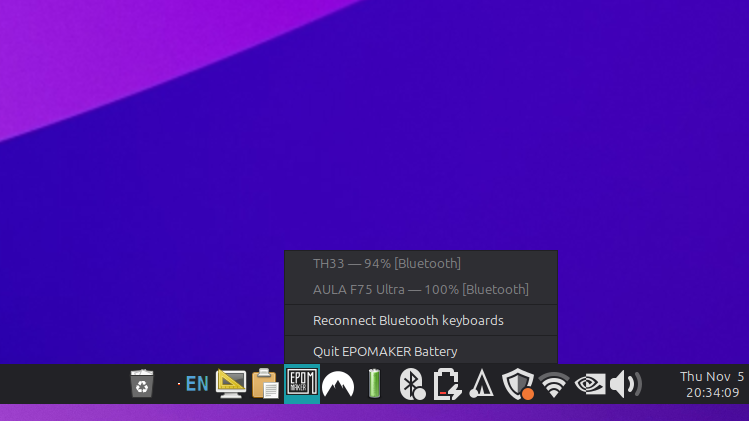

# EPOMAKER Battery

Live battery levels for your wireless keyboards — in the Linux taskbar.

A tray applet + background watcher that shows the real-time battery of
**EPOMAKER / AULA F75 Ultra / TH33** keyboards (and any other Bluetooth
keyboard or mouse that reports battery), with low-battery notifications and
automatic reconnection of Bluetooth links that die after the keyboard sleeps.



## Why this exists

The EPOMAKER x AULA F75 Ultra and EPOMAKER TH33 are excellent keyboards, but
on Linux two things are needlessly hard:

1. **You can't see the battery level.** There is no OS integration out of the
   box — no indicator, no `upower` entry you'd notice, no LED that tells you
   "4% left". You find out when typing stops mid-sentence.
2. **The vendor web configurator is fragile on Linux.** It needs a browser
   with WebHID, correct USB permissions (which Linux doesn't grant for these
   devices by default), the wired connection specifically, and the right JSON
   definition file loaded manually. Small things make it fail with
   `NotAllowedError` or "Received invalid protocol version".

While investigating the second problem, we discovered something useful about
the first: **both keyboards broadcast their battery over Bluetooth** (standard
GATT Battery Service), and Linux's `upower` already sees it — it just nobody
surfacing it in the desktop. This project surfaces it.

## What you get

- **Tray icon + label** — one compact line per session: `⌨94  ⌨100`. EPOMAKER
  wordmark icon normally, themed warning glyphs at ≤20% / ≤10%, lightning bolt
  when a device reports charging.
- **Menu with detail** — every device, its charge, and *which transports the
  computer can see* (Bluetooth / USB cable / 2.4G dongle).
- **Notifications** — low battery (≤20% then ≤10%), charging, unplugged,
  reconnected. De-duplicated: no notification pile-ups.
- **Automatic recovery of dropped Bluetooth links.** These keyboards deep-sleep
  to save power, and the Linux Bluetooth adapter can then hold a zombie
  "Connected: yes" link while keys silently stop arriving. The watcher
  reconnects dropped keyboards (3 attempts per 30-minute window), and an
  included udev rule stops the adapter itself from auto-suspending — the root
  cause of the zombie-link problem on Intel adapters.
- **Manual "Reconnect Bluetooth keyboards"** menu item for the stubborn cases.
- **Works with any brand** that reports battery over Bluetooth (Keychron,
  Logitech, ProtoArc, …). `--epomaker-only` restricts it to EPOMAKER/AULA.

## Install

Grab one of the two assets from the
[latest release](../../releases/latest):

### Ubuntu / Debian / Mint — `.deb` (recommended)

```bash
sudo apt install ./epomaker-battery_1.0.1-1_all.deb
```

The applet starts automatically at your next login. Remove with
`sudo apt remove epomaker-battery` (or `--purge` to also drop the udev rules).

### Any other distro — tarball (no root needed)

```bash
tar xzf epomaker-battery-1.0.1.tar.gz
cd epomaker-battery-1.0.1
./install.sh              # add --with-udev if you also want the udev rules
```

Installs into `~/.local/share/epomaker-battery` and registers itself in your
desktop's autostart. Undo with `./uninstall.sh`.

### From source (advanced)

Clone this repo and run the scripts directly, or wire up the two example
user-level systemd units in `battery/` (see `battery/README.md`).

### Requirements

`python3`, `upower`, `python3-gi` and AppIndicator support
(`gir1.2-ayatanaappindicator3-0.1`, or the classic `gir1.2-appindicator3-0.1`;
on **GNOME** also enable the *AppIndicator and KStatusNotifierItem Support*
shell extension). Debian/Ubuntu:
`sudo apt install python3 python3-gi upower gir1.2-ayatanaappindicator3-0.1 notification-daemon`.

## Limitations — please read before installing

Honest boundaries, learned the hard way during the investigation documented in
this repo:

1. **Battery is only visible over Bluetooth.** Neither keyboard sends its
   battery level over the USB cable or the 2.4G dongle — the firmware simply
   doesn't put it on those transports (verified against EPOMAKER's own QMK
   sources and live HID probing). A keyboard used via dongle/cable shows in
   the tray with `?` and no BT battery path until it is *also* paired over
   Bluetooth. The good news: these keyboards keep a Bluetooth link alive even
   while you type on 2.4G (F75 Ultra) and charge state aside, **pairing over
   Bluetooth is free** — you don't have to *use* it.

2. **"Charging" is usually not reported.** The BLE Battery Service these
   keyboards implement carries percentage only. `state` reads as `unknown`
   (we hide the word, but that means no charging bolt for EPOMAKER devices).
   Some other brands (e.g. certain mice) do report charging, and those
   work fully.

3. **The keyboard must be paired with *this* computer.** Unpaired keyboards
   are invisible — there is no scanning, this tool reads what BlueZ/upower
   already knows. Pairing is done in your normal Bluetooth settings; the
   keyboards enter pairing mode via their own function keys (see
   [EPOMAKER's app/hub](https://hub.getepomaker.com) or your manual).

4. **Sleepy keyboards still drop their link.** Deep sleep is the firmware's
   power-saving design and cannot be disabled from the host. The watcher
   reconnects automatically (and the udev rule removes the worst cause), but
   a keyboard that has been asleep a long time may need you to press a key —
   or use the tray's *Reconnect Bluetooth keyboards* item. Expect brief gaps
   between "asleep" and "reconnected", not a permanently live link.

5. **The Bluetooth-adapter udev rule is Intel-specific** (`8087:*`). On other
   chipsets (Realtek, MediaTek, …) the zombie-link fix does nothing until you
   add the matching USB IDs to `setup/98-bt-power.rules`. Also, keeping the
   radio from auto-suspending costs a small amount of laptop battery — it is a
   deliberate trade.

6. **The HID udev rules widen access on purpose.** `99-epomaker.rules` sets
   `/dev/hidraw*` nodes for these keyboards (and their receivers) to `0666` so
   your browser's WebHID and this daemon can talk to them without root. On a
   multi-user machine this means *any local user* can send HID reports to your
   keyboard while it's plugged in. Standard practice for VIA/WebHID users;
   remove the rule if you don't want it.

7. **The 2.4G "idle drop" quirk may not apply.** Older kernels (≤6.11) drop
   the F75 Ultra's 2.4G dongle after ~1 minute idle. `setup/epomaker-usbhid.conf`
   fixes this on kernels where `usbhid` is a loadable module — but on Ubuntu's
   shipped kernels `usbhid` is built into the image, so `modprobe.d` is ignored
   and you would need the GRUB parameter
   `usbhid.quirks=0x0c45:0xfefe:0x400` instead. (Newer kernels gained an
   upstream quirk for this device; check before changing anything.)

8. **Transport labels are presence, not activity.** `via [2.4G dongle]` means
   the receiver is plugged in and enumerated — the keyboard may still be
   actively typing over Bluetooth (they can hold both links). Treat it as
   "paths available", not "the one it's using right now".

9. **Tested environment.** Developed and CI-tested on Ubuntu 24.04 LTS, MATE
   desktop, X11, ThinkPad hardware. Other desktops work if AppIndicator
   support exists (GNOME needs the shell extension); headless sessions
   degrade gracefully to the `--once` command-line output. Wayland is untested.
   The tray-notification de-duplication uses
   `x-canonical-private-synchronous`, which MATE/Ubuntu's notification daemons
   honor; stricter daemons may show duplicates.

10. **Battery percentages are whatever the keyboard reports.** Expect steps
    rather than smooth curves (firmware polls its own fuel gauge every ~4s
    and only broadcasts on change), and stale values while the keyboard sleeps
    — a sleeping device disappears from upower and shows as offline until it
    rejoins.

11. **This is not a remapping tool.** It does exactly one thing: battery
    visibility and link recovery. Key remapping lives in
    [EPOMAKER Hub](https://hub.getepomaker.com) or
    [VIA](https://usevia.app) (with the udev rules from this repo installed,
    and usually wired — see `dist/README-user.md` notes).

12. **No affiliation.** Not an EPOMAKER product. Trademarks belong to their
    owners; this project was built from publicly available sources and
    on-device observation.

## How it works (in 10 seconds)

```
keyboard BLE GATT Battery Service (0x180F)
        → BlueZ → upower "keyboard_dev_<MAC>" entries
        → battery-watch.py (D-Bus signals, notifications, auto-reconnect)
        → battery-tray.py   (AppIndicator icon + menu, lsusb transport table)
```

No kernel modules, no compiled code, nothing root-resident beyond two optional
udev rules. `--once` on either script prints a plain status snapshot and exits
(useful in cron, dotfiles, or CI).

## Repo layout

| Path | What |
|---|---|
| `battery/` | The two Python tools + example systemd user units + logo asset |
| `setup/` | udev rules (hidraw access, Bluetooth autosuspend) + usbhid quirk |
| `install-setup.sh` | Guided installer for the rules (root) |
| `check.sh` | Diagnostics snapshot — permissions, battery paths, BT pairing |
| `dist/` | Packaging: `install.sh` / `uninstall.sh` (tarball) + `build-package.sh` (builds the `.deb` and tarball) |
| `docs/` | Screenshot |

## Troubleshooting

- No icon? GNOME → enable the AppIndicator shell extension. Then
  `python3 battery/battery-tray.py --once` — if *that* lists your keyboard,
  pairing and battery reporting work and the problem is only the shell.
- Keyboard listed but `?` battery → it's on cable/2.4G only; pair it over
  Bluetooth (see limitation 1).
- Keys stop arriving after sleep → install the udev rules
  (`sudo ./install-setup.sh`, or via `./install.sh --with-udev` / the `.deb`),
  and use the tray's Reconnect item.
- Still stuck → run `./check.sh` and read the snapshot; almost always a
  pairing or permissions issue.

## License

MIT — see [LICENSE](LICENSE).
